# Zuke's build graph

<!-- Generated by `./zuke graphDoc` — do not edit by hand. -->

The dependency graph of [`build.ts`](../build.ts) — Zuke building itself. An
arrow points from a dependency to the target that depends on it, so a target
runs after everything that points at it. This is the same graph `./zuke graph`
prints as text and `./zuke graph --output=html` renders interactively.

66 target(s), 44 dependency edge(s). Regenerate with `./zuke graphDoc`; the
`graphDocCheck` target in the CI gate fails when this page drifts from the
build.

```mermaid
flowchart TD
  t0["clean"]
  t1["restore"]
  t2["npmInstall"]
  t3["format"]
  t4["lint"]
  t5["oxlint"]
  t6["spell"]
  t7["check"]
  t8["tsc"]
  t9["test"]
  t10["nodeTest"]
  t11["integration"]
  t12["coverage"]
  t13["provisionTools"]
  t14["coverageUpload"]
  t15["apiDocs"]
  t16["apiDocsCheck"]
  t17["apiReference"]
  t18["syncWebsite"]
  t19["docLint"]
  t20["snippetsCheck"]
  t21["examplesCheck"]
  t22["toolSpec"]
  t23["toolSpecCheck"]
  t24["hclGen"]
  t25["hclSyncCheck"]
  t26["pluginSync"]
  t27["pluginSyncCheck"]
  t28["packageJsonSync"]
  t29["packageJsonSyncCheck"]
  t30["launcherSync"]
  t31["launcherSyncCheck"]
  t32["skillsCheck"]
  t33["graphDoc"]
  t34["graphDocCheck"]
  t35["pluginVersionCheck"]
  t36["prBodyLint"]
  t37["coreFloorCheck"]
  t38["lockCheck"]
  t39["security"]
  t40["actionPinCheck"]
  t41["npmSmoke"]
  t42["npmSigstoreCheck"]
  t43["ci"]
  t44["scorecard"]
  t45["codeql"]
  t46["reviewBase"]
  t47["review"]
  t48["release"]
  t49["actionRelease"]
  t50["publishJsr"]
  t51["npmBuild"]
  t52["publishNpm"]
  t53["npmVerify"]
  t54["npmTrust"]
  t55["cliBinaries"]
  t56["cliSign"]
  t57["cliPackage"]
  t58["cliUpload"]
  t59["cliFormulaVerify"]
  t60["cliTap"]
  t61["pythonSync"]
  t62["cliChocolateyVerify"]
  t63["cliChocolatey"]
  t64["publish"]
  t65["default"]
  t2 --> t3
  t2 --> t5
  t2 --> t6
  t1 --> t7
  t2 --> t8
  t7 --> t9
  t2 --> t10
  t9 --> t12
  t12 --> t14
  t13 --> t14
  t2 --> t24
  t2 --> t25
  t2 --> t33
  t2 --> t34
  t13 --> t39
  t3 --> t43
  t4 --> t43
  t5 --> t43
  t8 --> t43
  t6 --> t43
  t12 --> t43
  t14 --> t43
  t16 --> t43
  t19 --> t43
  t20 --> t43
  t21 --> t43
  t25 --> t43
  t27 --> t43
  t31 --> t43
  t29 --> t43
  t32 --> t43
  t34 --> t43
  t23 --> t43
  t35 --> t43
  t36 --> t43
  t40 --> t43
  t41 --> t43
  t42 --> t43
  t39 --> t43
  t38 --> t43
  t46 --> t47
  t48 --> t64
  t50 --> t64
  t43 --> t65
```

## Targets

| Target                 | Description                                                                                                                   | Depends on                                                                                                                                                                                                                                                                                                                                                                            |
| ---------------------- | ----------------------------------------------------------------------------------------------------------------------------- | ------------------------------------------------------------------------------------------------------------------------------------------------------------------------------------------------------------------------------------------------------------------------------------------------------------------------------------------------------------------------------------- |
| `clean`                | Remove build artifacts                                                                                                        | —                                                                                                                                                                                                                                                                                                                                                                                     |
| `restore`              | Warm the module cache                                                                                                         | —                                                                                                                                                                                                                                                                                                                                                                                     |
| `npmInstall`           | Install the npm workspace from its lock                                                                                       | —                                                                                                                                                                                                                                                                                                                                                                                     |
| `format`               | Check formatting (dprint check)                                                                                               | `npmInstall`                                                                                                                                                                                                                                                                                                                                                                          |
| `lint`                 | Lint the workspace (deno lint)                                                                                                | —                                                                                                                                                                                                                                                                                                                                                                                     |
| `oxlint`               | Lint the workspace with Oxlint                                                                                                | `npmInstall`                                                                                                                                                                                                                                                                                                                                                                          |
| `spell`                | Spell-check the repository (cspell)                                                                                           | `npmInstall`                                                                                                                                                                                                                                                                                                                                                                          |
| `check`                | Type-check the whole workspace                                                                                                | `restore`                                                                                                                                                                                                                                                                                                                                                                             |
| `tsc`                  | Type-check the workspace with tsc                                                                                             | `npmInstall`                                                                                                                                                                                                                                                                                                                                                                          |
| `test`                 | Run the test suite with coverage                                                                                              | `check`                                                                                                                                                                                                                                                                                                                                                                               |
| `nodeTest`             | Run the test suite on Node with Vitest                                                                                        | `npmInstall`                                                                                                                                                                                                                                                                                                                                                                          |
| `integration`          | Run the subprocess e2e suite (real processes, OS matrix)                                                                      | —                                                                                                                                                                                                                                                                                                                                                                                     |
| `coverage`             | Enforce the 95% coverage gate                                                                                                 | `test`                                                                                                                                                                                                                                                                                                                                                                                |
| `provisionTools`       | Provision the pinned scanner binaries into .zuke/tools                                                                        | —                                                                                                                                                                                                                                                                                                                                                                                     |
| `coverageUpload`       | Upload the coverage report to Codecov                                                                                         | `coverage`, `provisionTools`                                                                                                                                                                                                                                                                                                                                                          |
| `apiDocs`              | Generate agent-readable API docs (llms.txt, llms-full.txt, READMEs)                                                           | —                                                                                                                                                                                                                                                                                                                                                                                     |
| `apiDocsCheck`         | Verify the generated API docs are current                                                                                     | —                                                                                                                                                                                                                                                                                                                                                                                     |
| `apiReference`         | Generate the structured API reference (dist/api.json) for the website                                                         | —                                                                                                                                                                                                                                                                                                                                                                                     |
| `syncWebsite`          | Open and merge a website PR with refreshed llms.txt + api.json                                                                | —                                                                                                                                                                                                                                                                                                                                                                                     |
| `docLint`              | Fail on missing JSDoc or first-party private-type refs (deno doc --lint)                                                      | —                                                                                                                                                                                                                                                                                                                                                                                     |
| `snippetsCheck`        | Type-check marked doc snippets; ban inline jsr: imports                                                                       | —                                                                                                                                                                                                                                                                                                                                                                                     |
| `examplesCheck`        | Type-check every example, list its targets, verify its CI                                                                     | —                                                                                                                                                                                                                                                                                                                                                                                     |
| `toolSpec`             | Regenerate packages/engine/spec/tools.json — every wrapper's tasks and settings, for SDK generators                           | —                                                                                                                                                                                                                                                                                                                                                                                     |
| `toolSpecCheck`        | Verify packages/engine/spec/tools.json matches the wrappers                                                                   | —                                                                                                                                                                                                                                                                                                                                                                                     |
| `hclGen`               | Regenerate the Terraform/OpenTofu wrappers from one template                                                                  | `npmInstall`                                                                                                                                                                                                                                                                                                                                                                          |
| `hclSyncCheck`         | Verify the Terraform/OpenTofu wrappers match their template                                                                   | `npmInstall`                                                                                                                                                                                                                                                                                                                                                                          |
| `pluginSync`           | Sync plugins/zuke/skills/ from skills/ (real copies, not a symlink)                                                           | —                                                                                                                                                                                                                                                                                                                                                                                     |
| `pluginSyncCheck`      | Verify plugins/zuke/skills/ matches skills/ (no drift)                                                                        | —                                                                                                                                                                                                                                                                                                                                                                                     |
| `packageJsonSync`      | Regenerate each package's workspace package.json from its deno.json                                                           | —                                                                                                                                                                                                                                                                                                                                                                                     |
| `packageJsonSyncCheck` | Verify each package's workspace package.json matches its deno.json                                                            | —                                                                                                                                                                                                                                                                                                                                                                                     |
| `launcherSync`         | Regenerate ./zuke and zuke.ps1 from @zuke/cli's launcher template                                                             | —                                                                                                                                                                                                                                                                                                                                                                                     |
| `launcherSyncCheck`    | Verify ./zuke and zuke.ps1 match @zuke/cli's launcher template                                                                | —                                                                                                                                                                                                                                                                                                                                                                                     |
| `skillsCheck`          | Validate skills/ against the Agent Skills spec (frontmatter, names)                                                           | —                                                                                                                                                                                                                                                                                                                                                                                     |
| `graphDoc`             | Regenerate docs/graph.md — this build's graph as a Mermaid page                                                               | `npmInstall`                                                                                                                                                                                                                                                                                                                                                                          |
| `graphDocCheck`        | Verify docs/graph.md matches the current build graph                                                                          | `npmInstall`                                                                                                                                                                                                                                                                                                                                                                          |
| `pluginVersionCheck`   | Verify a skills change also bumped the plugin version                                                                         | —                                                                                                                                                                                                                                                                                                                                                                                     |
| `prBodyLint`           | Fail if the PR body has code release-please's parser can't handle                                                             | —                                                                                                                                                                                                                                                                                                                                                                                     |
| `coreFloorCheck`       | Type-check every package against the @zuke/core version it declares                                                           | —                                                                                                                                                                                                                                                                                                                                                                                     |
| `lockCheck`            | Verify the run did not rewrite deno.lock                                                                                      | —                                                                                                                                                                                                                                                                                                                                                                                     |
| `security`             | Run supply-chain security scanners (zuke/security)                                                                            | `provisionTools`                                                                                                                                                                                                                                                                                                                                                                      |
| `actionPinCheck`       | Verify the workflows only use inputs the released action has                                                                  | —                                                                                                                                                                                                                                                                                                                                                                                     |
| `npmSmoke`             | Install the npm build of core, deno and cli into a scratch project and run both under Node                                    | —                                                                                                                                                                                                                                                                                                                                                                                     |
| `npmSigstoreCheck`     | Check that sigstore-js verifies a real npm attestation under its own identity and refuses ours                                | —                                                                                                                                                                                                                                                                                                                                                                                     |
| `ci`                   | Full pre-commit / CI gate                                                                                                     | `format`, `lint`, `oxlint`, `tsc`, `spell`, `coverage`, `coverageUpload`, `apiDocsCheck`, `docLint`, `snippetsCheck`, `examplesCheck`, `hclSyncCheck`, `pluginSyncCheck`, `launcherSyncCheck`, `packageJsonSyncCheck`, `skillsCheck`, `graphDocCheck`, `toolSpecCheck`, `pluginVersionCheck`, `prBodyLint`, `actionPinCheck`, `npmSmoke`, `npmSigstoreCheck`, `security`, `lockCheck` |
| `scorecard`            | OpenSSF Scorecard (runs in CI via scorecard.yml)                                                                              | —                                                                                                                                                                                                                                                                                                                                                                                     |
| `codeql`               | CodeQL static analysis (runs in CI via codeql.yml)                                                                            | —                                                                                                                                                                                                                                                                                                                                                                                     |
| `reviewBase`           | Fetch the base branch the AI review diffs against                                                                             | —                                                                                                                                                                                                                                                                                                                                                                                     |
| `review`               | AI review of the diff (security + code quality)                                                                               | `reviewBase`                                                                                                                                                                                                                                                                                                                                                                          |
| `release`              | Maintain release PRs and GitHub releases (release-please)                                                                     | —                                                                                                                                                                                                                                                                                                                                                                                     |
| `actionRelease`        | Tag a new version of the Marketplace action when it changed                                                                   | —                                                                                                                                                                                                                                                                                                                                                                                     |
| `publishJsr`           | Publish new package versions to JSR, core first                                                                               | —                                                                                                                                                                                                                                                                                                                                                                                     |
| `npmBuild`             | Compile every package for npm into dist/npm                                                                                   | —                                                                                                                                                                                                                                                                                                                                                                                     |
| `publishNpm`           | Publish new package versions to npm as @zuke-build/*                                                                          | —                                                                                                                                                                                                                                                                                                                                                                                     |
| `npmVerify`            | Verify every published npm package against a rebuild of the commit its provenance names                                       | —                                                                                                                                                                                                                                                                                                                                                                                     |
| `npmTrust`             | Register release.yml as each package's npm trusted publisher (run once, locally, after the first publish; npm 11.15+ and 2FA) | —                                                                                                                                                                                                                                                                                                                                                                                     |
| `cliBinaries`          | Compile the CLI's standalone binaries when its release lacks them                                                             | —                                                                                                                                                                                                                                                                                                                                                                                     |
| `cliSign`              | Sign and notarize the CLI's macOS binaries (macOS only)                                                                       | —                                                                                                                                                                                                                                                                                                                                                                                     |
| `cliPackage`           | Pack the CLI's binaries into release archives and SHA256SUMS                                                                  | —                                                                                                                                                                                                                                                                                                                                                                                     |
| `cliUpload`            | Attach the CLI's archives, attestation and SHA256SUMS to its draft release, then publish it                                   | —                                                                                                                                                                                                                                                                                                                                                                                     |
| `cliFormulaVerify`     | Install the CLI's formula with the real brew and test it                                                                      | —                                                                                                                                                                                                                                                                                                                                                                                     |
| `cliTap`               | Publish the CLI's formula to the Homebrew tap                                                                                 | —                                                                                                                                                                                                                                                                                                                                                                                     |
| `pythonSync`           | Start the Python SDK's engine sync for the new CLI release                                                                    | —                                                                                                                                                                                                                                                                                                                                                                                     |
| `cliChocolateyVerify`  | Install the CLI's Chocolatey package with choco and run it                                                                    | —                                                                                                                                                                                                                                                                                                                                                                                     |
| `cliChocolatey`        | Push the CLI's Chocolatey package to the community repository                                                                 | —                                                                                                                                                                                                                                                                                                                                                                                     |
| `publish`              | Release then publish new versions to JSR                                                                                      | `release`, `publishJsr`                                                                                                                                                                                                                                                                                                                                                               |
| `default`              | Default: run the full CI gate                                                                                                 | `ci`                                                                                                                                                                                                                                                                                                                                                                                  |
